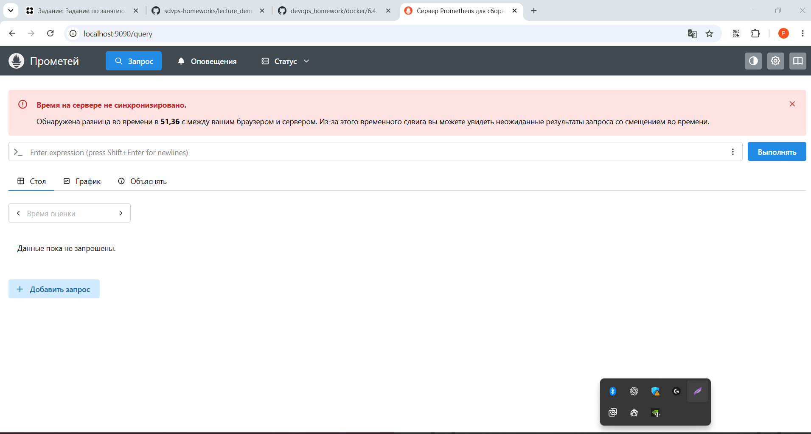

# 6.4. Docker. Часть 2

**Студент:** Гильмутдинов Руслан

## Задание 1

Docker Compose — инструмент для управления многоконтейнерными приложениями с помощью
единого YAML-файла. Он позволяет запускать несколько связанных сервисов одной командой,
настраивать сети, тома и переменные окружения.
Лично мне Docker Compose пригодится при разработке Python Backend-приложений:
я смогу быстро запускать приложение вместе с PostgreSQL и Redis,
не настраивая каждый контейнер вручную. Это позволит экономить время, 
создавать одинаковое окружение на разных компьютерах и упростит развёртывание моих проектов.

## Задание 2

Создан файл `docker-compose.yml` на основе конфигурации из лекции.

Настроена сеть `gilmutdinov-rg-my-netology-hw` с подсетью `10.5.0.0/16`.

### Конфигурация Docker Compose

```yaml
version: '3'
services:
  server:
    build: .
    command: python snake.py
    restart: unless-stopped
  nginx:
    image: nginx:alpine
    volumes:
      - ./onlinesnake.template:/etc/nginx/conf.d/onlinesnake.template
      - ./web/:/var/www/onlinesnake.fun/
    ports:
      - 8080:80
    command: /bin/sh -c "cat /etc/nginx/conf.d/onlinesnake.template > /etc/nginx/conf.d/default.conf && nginx -g 'daemon off;'"
networks:
  default:
    name: gilmutdinov-rg-my-netology-hw
    ipam:
      config:
        - subnet: 10.5.0.0/16 
volumes: {}
```

## Задание 3

В Docker Compose добавлен сервис Prometheus с именем контейнера `gilmutdinov-rg-netology-prometheus`.

Подключены файл конфигурации `prometheus.yml` и именованный том `prometheus_data` для хранения метрик.

Порт `9090` опубликован на Docker-хосте. Проверена доступность веб-интерфейса Prometheus из Windows через проброс порта VirtualBox.

### Проверка работы Prometheus



## Задание 4. Pushgateway

В существующий docker-compose.yml добавлен сервис Pushgateway.

Для запуска используется образ prom/pushgateway:latest.

Имя контейнера: gilmutdinov-rg-netology-pushgateway.

Настроен проброс порта 9091:9091, обеспечивающий доступ
к Pushgateway через порт 9091 Docker-сервера.

Контейнер успешно запущен и проверен командой docker ps.
Для доступа из Windows настроен проброс порта 9091
через NAT в Oracle VirtualBox.

Веб-интерфейс доступен по адресу http://localhost:9091.

Скриншот результата: [Pushgateway](6.4-compose/Pushgateway.png).

## Задание 5. Grafana

В docker-compose.yml добавлен сервис Grafana.

Используется образ grafana/grafana:latest.
Имя контейнера: gilmutdinov-rg-netology-grafana.

Настроен проброс порта 80:3000 для внешнего доступа.

Для хранения данных создан том grafana_data.
Файл custom.ini подключён к контейнеру в режиме только чтения.

Через переменную GF_PATHS_CONFIG указан путь к файлу настроек.
В custom.ini установлен логин gilmutdinov-rg и пароль netology.

Контейнер успешно запущен, веб-интерфейс доступен
из Windows по адресу http://localhost.

Скриншот: [Grafana](6.4-compose/Grafana.png).
